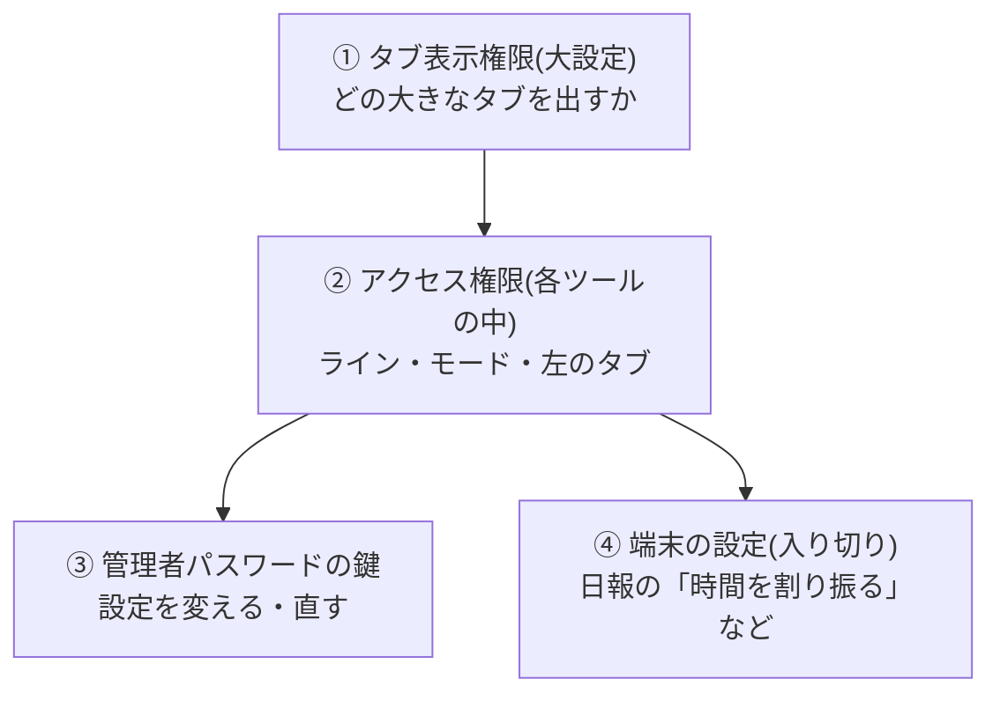

# アクセス権限と配布設定(閉じるもの・開くもの)

日報複合ツール(VER1.5.73)と4つのツール(日報 4.44.11・看板 3.5.16・カレンダー 4.2.15・点検表 2.4.10)で、
**どこで何を絞っているか**、**何が見えなく/押せなくなり、何が誰でも使えるか**、**配布設定で何を配れるか**を
1枚にまとめたものです。細かい理由は各ツールの文書にあります(いちばん下の「詳しくは」)。

> 管理者パスワードの既定の値は、この文書には書きません。

## 1. どこで何を絞るか(全体像)

絞るところは4つあります。**それぞれ別のもの**で、1つを変えてもほかは変わりません。

| | 何で決まるか | どこに書くか | 決めるもの |
|---|---|---|---|
| ① タブ表示権限 | ログインID・PC名 | 共有の DB の表「タブ表示権限」(大設定で書く) | 日報・看板・カレンダー・点検表のどの大きなタブを出すか |
| ② アクセス権限 | ログインID・PC名 | 梱包資材マスタの表「アクセス権限」(各ツールのマスタ管理で書く) | 日報: ライン・左のタブ・ほかのラインの記録 / 看板: モード・担当ライン / カレンダー: 使えるライン |
| ③ 管理者パスワードの鍵 | パスワードを知っているか | ツールごとにその端末に持つ(配布設定で配れる) | 設定を変える・マスタを直す・配布設定を書き出す など |
| ④ 端末の設定 | その端末の入り切り | その端末の設定(配布設定で配れる) | 日報の「時間を割り振る」「LOTで時間を割り振る」を出すか |

- ①はタブを出すかどうかだけです。タブの中で何ができるかは②〜④で決まります。
- ②は「誰か(どの端末か)」で決まり、パスワードでは変わりません。③は「パスワードを知っているか」で、
  ソースのことばで「アクセス制御ではなく、うっかり書き換えないための守り」です。

### 1-1. タブ表示権限(大設定)

共有の DB(既定は `梱包資材マスタ.sqlite3`)の表「タブ表示権限」(列: 管理番号・ログインID・PC名・表示タブ・既定タブ・有効・備考)で決めます。
書き換えは大設定で鍵を開けてから(「表を作る」「+ 行を足す」「直す」「消す」)。「共有から読み直す」は鍵なしで押せます。

| 場合 | 出る大きなタブ |
|---|---|
| この端末に当てはまる行がある | その行(複数なら全部足す)の表示タブ + 大設定 |
| 表に有効な行があるのに、この端末の行が無い(登録の無い端末) | **大設定だけ**(ログインID・PC名が「写す」で写せる形で出る) |
| 表がまだ無い・有効な行が1行も無い | すべてのタブ |
| 共有に届かない | 前回読めた手元の写し(`%LOCALAPPDATA%\AllTools\data\tab_rights_cache.json`)で決める。写しも無ければすべてのタブ |

- 空欄は「問わない」。ログインIDもPC名も空の行は効きません。`有効` が 0 などの行は飛ばします。
- **既定タブ**(起動したときに開くタブ)は、当てはまる行のうちいちばん絞った行(ID と PC の両方 → PC だけ → ID だけ)のもの。
  無ければ、その端末で前回開いていたタブ、それも無ければ左端のタブです。
- 開いているあいだにタブが増えたら1分ほどで足し、外れたタブは次に開いたときに消します。
- 出さないタブのツールは起こしません。**そのツールの配布設定も、そのツールが起きるまで読まれません。**

### 1-2. アクセス権限(各ツールの中)

梱包資材マスタの表「アクセス権限」(列: 管理番号・ログインID・PC名・権限・有効・備考)を、日報・看板・カレンダーが
**同じ表を別々の決まりで**読みます。点検表は読みません。大設定の「アクセス権限の早見表」にも同じものが出ます。

| | 日報 | 看板 | カレンダー |
|---|---|---|---|
| どこの表を読むか | 日報の参照設定の伝送用ファイル・梱包資材マスタ・VC計算マスタの順に探し、この端末の行がある表 | 看板の設定の「アクセス権限の置き場所(梱包資材マスタ)」 | マスタDB の置き場所の梱包資材マスタ |
| 読むとき | 起動したとき・設定・管理者の「読み直す」(誰でも押せる) | 起動したとき・モードを切り替えるとき など | 起動したとき・同期で表を取り込み直したとき |
| `Administrator` | どのラインの日報も「記録を見る」で見て直せる(パスワード不要)。集計管理・集計グラフでラインを選べる。左のタブ 1〜8 を全部 | 現場モード・倉庫モードの両方 | 読まない |
| `mode:fullaccess` | 左のタブ 1〜8 を全部 | 読まない | 読まない |
| `mode:field` / `mode:material` | 読まない | 現場モード / 倉庫モード | 読まない |
| ライン名 | この端末のライン(1つだけのとき) | 担当ライン(1つだけのとき) | 使えるライン(1つなら固定・複数ならその中で選ぶ。`作業長` は全ラインを見るライン) |
| 当てはまる行が無い | ラインは設定・管理者で選ぶ。左のタブは 1・2・3・5・8 だけ | 現場モードだけ | 管理者パスワードで、どのラインにも切り替えられる |
| 表を読めない | 左のタブは全部出す(ラインは前のまま) | 前回読めた内容で決める。それも無ければ現場モードだけ | (確かめていない) |

- 日報の左のタブを絞るのは `app/shell.py` の `LIMITED_NAV`(1 日報入力・2 梱包資材重量計算・3 VC長さ計算・5 集計・グラフ・8 設定・管理者)。
  4 記録を見る・6 集計管理・7 標準作業時間は**レールに出さないだけ**で、画面そのものは消しません(日報入力の「前の直を呼び出す」などからは開けます)。
- **日報入力はどの端末でも出ます**(絞った形にも入っている)。
- ライン名の書き方(この字のとおり。`L1` `LS` などは読まない)は [日報複合ツール.md](日報複合ツール.md) の「ライン名の一覧」。

### 1-3. 管理者パスワードの鍵

パスワードは**ツールごとに別々**に、その端末に撹拌した値で持ちます(1つのツールで変えても、ほかのツールは変わりません)。

| どこ | 鍵の開け方 | 開いている長さ | 鍵で開くもの(主なもの) |
|---|---|---|---|
| 大設定 | 「鍵を開ける」 | 30分さわらなければ掛かる | タブ表示権限の書き換え・共有の DB の置き場所・配布設定(書き出す・読み込み直す・消す) |
| 日報(設定・管理者) | 面の上の鍵(=管理者モード) | 印の ✕ で終わる・**直が変わると自動で外れる** | 参照設定のパス・この端末のライン・「時間を割り振る」の入り切りと倍率・配布設定・取り込みと直し・マスタを直す・過去の直/ほかの直を呼び出して直す・GW計算の記録の形式 |
| 看板(設定) | 「パスワード認証」(守られた操作の確認でも開く) | 30分さわらなければ掛かる | 担当ライン・接続先などの置き場所・マスタの編集・未反映の片付け・配布設定 |
| カレンダー(設定) | 守られた値が本当に変わるときに訊かれる | (その操作ごと) | この端末のライン・参照パス・アクセス権限の行・端末一覧の「次のライン」・配布設定 |
| 点検表(設定) | 操作のたびに入れる | (その操作ごと) | 配布設定・管理者パスワードの変更 |

- **看板だけは既定のパスワードがありません。** 決めないまま置くと、最初に設定を変えようとした人が決められます。
  看板のパスワードを決めてから配布設定に入れて配ってください。
- 大設定の鍵を開けても、各ツールの鍵は開きません(逆も同じ)。
- **パスワードではモード・ラインの権限は増えません**(看板のモード、カレンダーの表に無いライン、日報の集計のライン選択は②で決まる)。

## 2. 閉じるもの・開くもの

### 日報

| もの | 誰でも | 絞るもの |
|---|---|---|
| 1 日報入力・2 梱包資材重量計算・3 VC長さ計算・5 集計・グラフ・8 設定・管理者(左のタブ) | ○ | ― |
| 4 記録を見る・6 集計管理・7 標準作業時間(左のタブ) | × | アクセス権限 `mode:fullaccess` か `Administrator`(表を読めない日は全部出る) |
| いまの直を打つ・保存(確定)・共有へ保存・過去分を共有へ送る | ○ | この端末のラインが決まっていること・「作業者を選ぶ」のあと |
| 終わった直・ほかの直を呼び出して直す | × | 管理者モード(パスワード)か `Administrator` |
| 集計管理・集計グラフでほかのラインを選ぶ | × | `Administrator` だけ(管理者モードでは選べない) |
| この端末のラインを変える・パスを変える・取り込みと直し | × | 管理者モード(`Administrator` でも要る) |
| アクセス権限の「読み直す」 | ○ | ― |
| 設定の「音」「ログ」の面 | ○ | ― |
| **「時間を割り振る」「LOTで時間を割り振る」** | 端末の入り切りしだい | **アクセス権限に関係なく、端末の入り切り(下の 2-1)だけで決まる** |

### 看板

| もの | 誰でも | 絞るもの |
|---|---|---|
| 倉庫参照モード(見るだけ) | ○ | ― |
| 現場モード(発注・届いた確認・注文票の印刷) | 行が無い端末は現場モードだけ | 行がある端末は `mode:field` か `Administrator` |
| 倉庫モード(発送・注文中・発送明細の印刷) | × | `mode:material` か `Administrator` |
| モードの切り替え(設定 →「この端末」・右上の ⇄) | 権限のあるモードへなら ○(パスワードは訊かない) | アクセス権限 |
| 担当ライン・接続先・マスタの編集・未反映の片付け・配布設定 | × | 看板の管理者パスワード |

- 行が1つでもある端末は、その行のモードだけになります(`mode:material` だけ足すと現場モードは使えない)。

### カレンダー

| もの | 誰でも | 絞るもの |
|---|---|---|
| 休み・コメント/連絡の登録・内容閲覧・削除・印刷・履歴・今すぐ同期 | ○(参照パスが決まっていない端末は見る・印刷だけ) | ― |
| 連絡を残すラインを選ぶ・ほかのラインの登録を消す | × | ラインが `作業長` の端末 |
| この端末のラインを変える | × | 管理者パスワード。表に行がある端末は表のラインの中だけ(1つなら固定) |
| 参照パス・アクセス権限の行・配布設定 | × | 管理者パスワード |

### 点検表

| もの | 誰でも | 絞るもの |
|---|---|---|
| 探す・選ぶ・プレビュー・印刷 | ○ | ― |
| 設定の点検表フォルダ・ログの保存先と日数 | ○(パスワードは要らない) | ― |
| 配布設定・管理者パスワードの変更 | × | 管理者パスワード |

アクセス権限の表は読みません(ログインID・PC名で使える機能は変わりません)。

### 大設定

| もの | 誰でも | 絞るもの |
|---|---|---|
| この端末のログインID・PC名・出ているタブとその理由を見る | ○ | ― |
| 画面の色の既定・ブラウザ版で待つ時間 | ○(この端末だけに効く) | ― |
| タブ表示権限を「共有から読み直す」 | ○ | ― |
| タブ表示権限の書き換え・共有の DB の置き場所・配布設定 | × | 大設定の鍵 |
| 管理者パスワードを変える | × | いまのパスワード |

大設定のタブ自体は、どの端末にも必ず出ます。

### 2-1. 権限ではなく端末の設定で決まるもの

| もの | 決めるところ | 変えるには | 配れるか |
|---|---|---|---|
| 日報の「時間を割り振る」 | 設定・管理者 →「この端末と配布」→「時間を割り振る(日報入力)」の「「時間を割り振る」を使う」 | 管理者モード | ○ |
| 日報の「LOTで時間を割り振る」 | 同じ所の「「LOTで時間を割り振る」を使う」 | 管理者モード | ○ |
| 日報の「時間を割り振る」の倍率(EX・段取り・VC交換) | 同じ所 | 管理者モード | ×(端末ごと) |
| 看板の「どのモードで開くか」 | 設定 →「この端末」 | 権限のあるモードなら誰でも | ×(端末ごと) |
| 大設定の画面の色の既定 | 大設定 | 誰でも | × |

**「時間を割り振る」「LOTで時間を割り振る」の決まり方**(`tools/nippou/app/current.py` の `time_split_button`)

1. この端末の値(2つそれぞれ。書いていなければ、前の版の1つの入り切り `time_split_enabled` を引き継ぐ)
2. 無ければ配布設定の値
3. それも無ければ「使わない」

- `Administrator`・`mode:fullaccess`・タブ表示権限のどれとも関係しません。
- 「使わない」のボタンは日報入力に出しません。画面を通さずに呼ばれても断ります(`app/routes/entry.py` の `_distribute`。理由 `time_split_off`)。
- 「使う」でも、押せるのは**ラインが決まっていて、「作業者を選ぶ」のあと**です。見るだけの画面(直の時間が過ぎた・過去の直を
  管理者モードでなく開いている)でも断ります。
- 設定の画面で、配布設定から来た値には「配布設定の値」の札が出ます。

## 3. 配布設定

### 3-1. どこに書き出すか・押すもの

| 押すもの | どこ | 書き出す先 | 中身 |
|---|---|---|---|
| 4ツールの分もまとめて書き出す | 大設定(鍵) | 一式の `配布設定\日報複合ツール.json` と、各ツールの `tools\<ツール>\配布設定\設定.json` | 大設定の分 + 4ツールの分(`tools` の中)。**4ツールの分は各ツールの設定画面の既定の選び方のまま** |
| 配布設定を書き出す | 大設定(鍵) | 一式の `配布設定\日報複合ツール.json` | 大設定の分だけ(入っている4ツールの分はそのまま残す) |
| 配布設定を書き出す | 各ツールの設定画面(管理者パスワード) | `tools\<ツール>\配布設定\設定.json` | そのツールの分。項目を選べる |
| 読み込み直す | 大設定(鍵) | ― | **大設定の分だけ**をこの端末に上書き |
| 配布設定を読み込み直す | 各ツールの設定画面(管理者パスワード) | ― | そのツールの分をこの端末に上書き |
| 消す | 大設定・各ツール | ― | 配布設定を消す(この端末の設定はそのまま) |

- 書き出すのは**その端末で変えた値だけ**です。既定のままの項目は入れません(配った先も既定で動くので要らない)。
  何も変えていなければ「既定のままなので要りません」と出ます。
- 大設定の「各ツールの配布設定(中身)」に、配った先が使うほうの項目と値が出ます(読むだけ)。配る前にここで確かめます。
- 配るときは一式の `scripts\make_dist.bat` を使います(書き出したものが全部入ります)。

### 3-2. ツールごとの配れる項目

○ = 各ツールの設定画面で最初からチェックが付いている(まとめて書き出すと入る)/ △ = 選んだときだけ入る(まとめて書き出すでは入らない)

**大設定**: 共有の DB のフォルダ ○・共有の DB のファイル名 ○・管理者パスワード ○

**日報**

| 項目 | |
|---|---|
| 参照用マスタの参照パス・仕掛ロット・引当・受注の置き場所(第1パス)・コイル割り数の置き場所(第1パス)・コイル割り数のファイル名(第1パス) | ○ |
| 仕掛の置き場所(第2パス)・仕掛ロットのファイル名(2つ目)・仕掛引当のファイル名(2つ目)・仕掛受注のファイル名(2つ目)・コイル割り数のファイル名(2つ目) | ○ |
| 梱包資材マスタの置き場所・伝送用ファイルの置き場所・ライン毎目標の置き場所・停止内訳の置き場所・VC計算マスタの置き場所 | ○ |
| 共有の日報管理のパス・日報データのファイル名・月別書き出しの出力パス・集計CSV・印刷用HTMLの出力パス・集計CSVの出力パス(2つ目)・標準作業時間CSVの出力パス | ○ |
| ログの出力パス・日報入力データの控えの置き場所・音声ファイルの参照パス・音声ファイルの名前・管理者パスワード | ○ |
| 「時間を割り振る」を使う・「LOTで時間を割り振る」を使う | ○ |
| この端末のライン(端末ごとに違う) | △ |
| 音声ファイル(この端末で鳴らしているもの) | △(`tools\nippou\配布設定\音` に入る。入れると音声ファイルの参照パスは入れない) |

**看板**: 接続先(共有DB)○・アクセス権限の置き場所(梱包資材マスタ)○・看板履歴の置き場所(看板履歴.sqlite3)○・取り込み間隔 ○・
書き戻し間隔 ○・自動印刷 ○・押し間違いとみなす時間(看板集計)○・管理者パスワード ○・担当ライン(端末ごとに違う)△・
CSV の書き出し先(端末ごとに違ってよい)△・記録(ログ)の置き場所(共有フォルダに集めるなら配る)△

**カレンダー**: 保存用DBの置き場所 ○・マスタDBの置き場所 ○・自動同期 ○・取り込み間隔(秒)○・ログフォルダ ○・管理者パスワード ○・ライン(端末ごとに違う)△

**点検表**: 点検表フォルダ ○・管理者パスワード ○・ログの保存先 ○・ログの保存日数 ○・表示(ダーク/ライト)△

### 3-3. 配れないもの・気をつけるもの

| もの | 扱い |
|---|---|
| ライン(日報・看板・カレンダー) | 既定で入らない(入れたまま配ると全端末が同じラインになる)。ふつうはアクセス権限の表で決める |
| 管理者パスワード | 撹拌した値で入る。配布設定からも大設定の一覧からも値は読めない(「(設定済み)」と出る) |
| 日報の音声ファイル | まとめたファイルには入らない。`tools\nippou\配布設定\音` のまま配る。配った先は、音の置き場所を決めていない端末だけ、その端末の中へ写して使う |
| タブ表示権限・アクセス権限の表 | 共有の DB / 梱包資材マスタにあるので、配る必要はない |
| 日報の「時間を割り振る」の倍率・GW計算の記録の形式 | 配布設定の項目に無い(端末ごとに管理者モードで決める) |
| 看板のモード・大設定の画面の色の既定・ブラウザ版で待つ時間 | 配布設定の項目に無い |

**まとめて書き出すと、各ツールのフォルダの配布設定を既定の選び方で書き直します。** 前に日報の設定画面でラインや
音声ファイルを入れて書き出していても、まとめて書き出すと外れます(日報の `配布設定\音` も消えます)。
入れたいものがあるツールは、**まとめて書き出したあとで**そのツールの設定画面で選んで書き出し直します。

### 3-4. 配った先での決まり(大設定・4ツールとも同じ)

1. **起動のときに読みます。** 大設定は入口が起きたとき、各ツールはそのツールが起きたとき。開いているあいだに配り直しても、
   開き直すまで端末の設定には入りません。
2. **その端末で決めた値は上書きしません。** 端末に値が無い項目だけ埋めます。
3. **配布設定から読み込んだ値は覚えておき**(`distribution_values`)、そのままなら、配り直した配布設定の**新しい値に置き換えます**。
   読み込んだあとにその端末で直した値は残します。
4. **揃えたいときは「読み込み直す」**(管理者パスワード)。その端末で決めた値も配布設定の値で上書きします。
   大設定の「読み込み直す」は大設定の分だけなので、各ツールの分は**そのツールの設定画面**で押します。
5. **ツールのフォルダとまとめたファイルの両方にあれば、作った時刻が新しいほう**を丸ごと使います(同じ時刻ならツールのフォルダのほう。項目ごとには混ぜない)。
6. 起動の記録(ログ)に、何を読んだか・その端末の値を残したかが1行出ます。

- 看板は、決めていなくても使う既定の置き場所と同じ値も「その端末で決めた値」に数えません(配った置き場所を隠さないため)。
- v4.44.6(日報)より前に読み込んだ端末は、読み込んだ値を覚えていないので、1度だけ「読み込み直す」が要ります。

## 4. よくある問い

**Q. 「時間を割り振る」を「使う」にして配布しておけば、アクセス権限に関係なく使えますか?**

A. はい。アクセス権限(`Administrator`・`mode:fullaccess`・ライン)とは関係なく、配った先の端末の入り切りで決まります。
配る元の PC で「「時間を割り振る」を使う」(と「「LOTで時間を割り振る」を使う」)を「使う」にしてから書き出してください
(一度も入り切りしていない PC からは、この項目は「既定のまま」で入りません)。効かないときは次を見ます。

| 見えること | わけ | すること |
|---|---|---|
| ボタンが出ない。設定の画面の「時間を割り振る」に「配布設定の値」の札が無い | その端末で前に入り切りした値が残っている(前の版の1つの入り切りを含む)。その端末で決めた値は上書きしない | その端末の設定・管理者 →「この端末と配布」→「配布設定を読み込み直す」(管理者パスワード)。または管理者モードでその場で「使う」 |
| 日報のタブが無い | 大設定のタブ表示権限で日報のタブが出ていない(日報が起きないので配布設定も読まれない) | 大設定でその端末の行に「日報」を足す |
| ボタンはあるが押せない | ラインが決まっていない・「作業者を選ぶ」の前・見るだけの画面 | ラインを決める・作業者を選ぶ・いまの直に戻る |
| 配り直したのに前のまま | 配布設定は起動のときに読む | 日報(または日報複合ツール)を閉じて開き直す。急ぐなら「配布設定を読み込み直す」 |
| 大設定の「各ツールの配布設定(中身)」に出ていない | まとめて書き出す前の古い配布設定・配る元で既定のまま | 配る元で「使う」にしてから書き出し直す |

**Q. `Administrator` にすれば「時間を割り振る」が出ますか?**

A. 出ません。ボタンは端末の入り切りだけで決まります。入り切りを変えるのも管理者モード(パスワード)で、`Administrator` では変えられません。

**Q. 大設定の「読み込み直す」を押したのに、日報(看板・カレンダー・点検表)の設定が揃いません。**

A. 大設定の「読み込み直す」は大設定の分(共有の DB の置き場所・管理者パスワード)だけです。各ツールの分は、そのタブの設定画面の
「配布設定を読み込み直す」で揃えます。

**Q. まとめて書き出したら、日報のラインや音声ファイルが配られなくなりました。**

A. まとめて書き出すと、各ツールの配布設定を既定の選び方で書き直します。日報の設定画面で、ライン・音声ファイルを選んで書き出し直してください(3-3)。

**Q. 新しい端末を置いたら、大設定のタブしか出ません。**

A. タブ表示権限に行があるのに、その端末の行が無いときです。大設定に出るログインID・PC名を写して行を足します。

**Q. 看板で倉庫モードを選べません。パスワードを入れても変わりません。**

A. 看板のモードはアクセス権限の表で決まります。その端末の行に `mode:material`(か `Administrator`)を足します。設定の画面に足す行の中身が出ます。

**Q. 配った先で、看板のパスワードを知らない人に決められてしまいました。**

A. 看板には既定のパスワードがありません。配る前に配る元で決めて、配布設定に入れて配ります(看板の設定画面の配布設定にも
「管理者パスワードが入っている」の確かめが出ます)。決められてしまった端末の戻し方は、この文書では確かめていません。係の人に頼んでください。

## 5. 詳しくは

| 中身 | 文書 |
|---|---|
| タブ表示権限・大設定・配布フォルダの作り方・アクセス権限の早見表 | [日報複合ツール.md](日報複合ツール.md) |
| 日報のモード(作業者・管理者モード・Administrator・mode:fullaccess) | [日報管理ツール.md](日報管理ツール.md) の「モード説明」 |
| 「時間を割り振る」「LOTで時間を割り振る」の使い方 | [使い方/日報入力テクニック集.md](使い方/日報入力テクニック集.md) |
| 看板のモード(現場・倉庫・倉庫参照) | [資材発注看板システム.md](資材発注看板システム.md) の「モード説明」 |
| カレンダーのアクセス権限・作業長 | [ライン管理カレンダー.md](ライン管理カレンダー.md) の「モード説明」 |
| 点検表の管理者パスワード | [点検表.md](点検表.md) の「モード説明」 |
| 版ごとの理由(配り直しで新しい値 v4.44.6・まとめたファイル v4.44.7・2つの入り切り v4.44.11) | `tools/nippou/README.md` |
