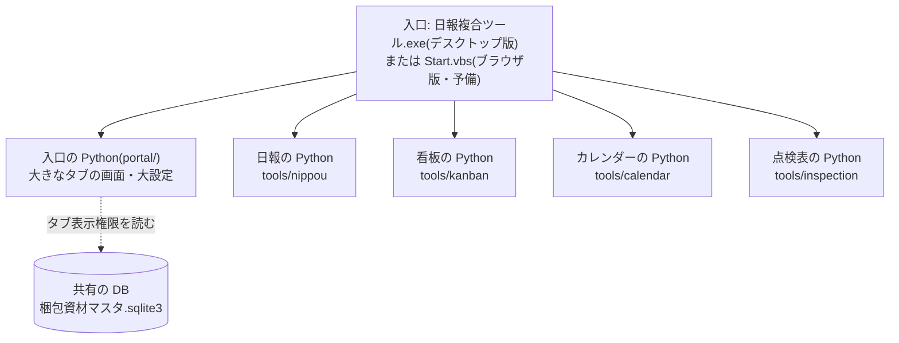

# 日報複合ツール(VER1.5.69)

日報・看板・カレンダー・点検表の4つのツールを、1つの入口(1つの窓)に大きなタブで並べたものです。
中は分けたまま動きます(ツールごとに別の Python)。どの端末にどのタブを出すかは「大設定」で決めます。

## 仕様

### 構成

- 4つのツールは、それぞれ別の Python(別のプロセス)で動きます。1つが止まっても、ほかのタブはそのまま使えます。
- 開いたタブのツールだけが動き始めます。最初のタブが出たあと、ほかのタブも順に裏で起こします。
- 出さないタブのツールの Python は起こしません。
- 大きなタブの並びは `config\tools.json` の並びです。

### デスクトップ版とブラウザ版の違い

| | デスクトップ版(ふだん) | ブラウザ版(予備) |
|---|---|---|
| 起動するもの | `日報複合ツール.exe` | `Start.vbs`(原因を見るときは `start.bat`) |
| 画面 | 専用の窓(Rust/Tauri。`src-tauri\`) | ふだんのブラウザ |
| ポート | 使いません(Python とは標準入出力でやりとり) | 入口は 127.0.0.1 の 8700〜8709 の空いている番号 |
| 各ツールの起こし方 | exe が `tools\<ツール>\bridge.py` を起こす | 入口が各ツールのブラウザ版を起こして枠に並べる |
| 終わり方 | 右上の「終了」・窓の × | 右上の「終了」・`stop.bat`・画面を閉じて約90秒(心拍) |
| `stop.bat` | 止めません(窓を前に出すだけ) | 止めます |
| 打ちかけの受け皿 | 自分で受けないツールの画面も受ける | 自分で受けるツール(日報・看板・カレンダー)だけ |
| Alt+1〜9 | どこで押しても効く | 大きなタブの帯をクリックしてから押す |
| 必要なもの | Python と Flask・WebView2 ランタイム(waitress は要らない) | Python と Flask・waitress・pythonw |

- 2つは同時に動きません。後から開いたほうが「〜が動いています」と出して止まります。
- exe をもう一度開いても2つ目は開かず、開いている窓が前に出ます。
- 各ツールの単体のブラウザ版(`tools\<ツール>\Start.vbs`)が先に動いていると、そのタブだけに理由と「もう一度開く」が出ます(ほかのタブは使えます)。

### 4つのツール

| タブ | ツール | 版 | 何をするか | 文書 |
|---|---|---|---|---|
| 日報 | 日報管理ツール | 4.44.9 | 日報の入力・保存・印刷・集計 | [日報管理ツール.md](日報管理ツール.md) |
| 看板 | 資材発注看板システム | 3.5.14 | 資材の看板・発注・届いた確認 | [資材発注看板システム.md](資材発注看板システム.md) |
| カレンダー | ライン管理カレンダー | 4.2.13 | 休み・連絡の登録と印刷 | [ライン管理カレンダー.md](ライン管理カレンダー.md) |
| 点検表 | 点検表 選択・印刷 | 2.4.9 | 点検表を探して選び、まとめて印刷 | [点検表.md](点検表.md) |
| 大設定 | (このリポジトリ) | ― | タブ表示権限・共有の DB の置き場所・配布設定 など | この文書 |

大きなタブには各ツールの版(各ツールの `config\app.json`)が出ます。窓が狭いときは版を隠し、タブに指を置くと出ます。

### 必要なもの

配布フォルダには Python のパッケージを**同梱しません**。各 PC に入っている Python とパッケージを使います。
次のものが入っていることが前提です。

| もの | 版 | デスクトップ版 | ブラウザ版 | 使うところ |
|---|---|---|---|---|
| Windows | 10 / 11 | 要る | 要る | 全体 |
| Python | 3.9 以上 | 要る | 要る | 入口と4ツール(デスクトップ版でも、要求を受けて処理するのは Python) |
| Flask | 3.0 系 | 要る | 要る | 入口と4ツールの画面と処理。デスクトップ版は待ち受けずに、外枠(Rust)から渡された要求を Flask のアプリで処理する |
| waitress | 3.0 系 | 要らない | 要る | ブラウザ版の待ち受け(WSGI サーバ) |
| WebView2 ランタイム | ― | 要る | 要らない | デスクトップ版の画面(Windows 11 には入っている) |
| Access(ACE)・Excel・Word | ― | 要る | 要る | 日報の Access 連携・点検表の印刷(cscript + VBScript で動かす) |

Flask を入れると、Flask が使う次のパッケージも一緒に入ります(どれも Python だけで書かれたもの):
Werkzeug・Jinja2・MarkupSafe・itsdangerous・click・blinker。

- 入れるときは `python -m pip install -r requirements.txt`(リポジトリの一番上の `requirements.txt` に Flask と waitress の2つ)。
  各ツールの `tools/<名前>/requirements.txt` も同じ2つです。
- 入っているかは `start.bat --check` で確かめられます(足りなければ何が無いかを出す)。デスクトップ版は、Flask が無いと
  起動の画面に「必要なパッケージが入っていません: Flask」と出ます。
- 上のほかに要るパッケージはありません(pyodbc・pandas・pywin32・Pillow などは使わない。Access・Excel・Word は
  Windows に入っている cscript + VBScript で動かす)。
- `scripts\make_shortcuts.vbs` は Windows の機能(WSH)だけで動くので、Python もパッケージも要りません。

### 起動・終了・止め方

| ファイル | 使うとき |
|---|---|
| `日報複合ツール.exe` | ふだんはこれ |
| `Start.vbs` | exe が使えないとき(ブラウザ版)。Python・pythonw・`start_app.py` が無ければ、その旨を出します |
| `start.bat` | ブラウザ版が起動しないとき、原因を見る(コンソールに経過が出る)。`start.bat --check` は確認だけ |
| `stop.bat` | ブラウザ版を止める |
| `launcher_check.bat` / `launcher_stop.bat` | 業務ツール統合ランチャー(1.7 以降)が使う起動確認・終了の入口 |

**終わるとき(どちらの版も)**

- 右上の「終了」・窓の ×・各ツールの画面の「終了」は、どれも同じ流れです。全部のタブがまとめて閉じます。
- 閉じる前に、各ツールの画面へ「打ちかけを置いて」と頼みます。置けなければ「続けますか?」と訊き、答えるまで閉じません。
- 全ツールに「終わってよいか」を訊き、書き戻し・印刷などの途中の処理があれば、1つの確認にまとめて出します。
  10秒待っても返事が無いツールも、この確認に並べます。
- 「終了する」を押すと中断して閉じます(送れなかった操作は手元に残り、次に開いたときに送ります)。

**ブラウザ版を止める(`stop.bat`)**

- 開いている画面に打ちかけを置いてもらってから、入口と各ツールのブラウザ版を止めます。ほかの Python は止めません。
- 終わったことを確かめてから「終わった」と言います。
- 途中の処理がある・終わらないツールがあるときは止めません。中断してよければ `stop.bat --force` を使います。
  `--force` は、それでも終わらないツールの Python を PID ごと(子ごと)止めます。

| `stop.bat` の戻り値 | 意味 |
|---|---|
| 0 | 止めた |
| 1 | デスクトップ版が動いている(止めない) |
| 2 | 止めなかった(途中の処理がある・画面で「閉じない」が選ばれた など) |
| 3 | Python が見つからない |

**ブラウザ版がひとりでに終わるとき(心拍)**

- 大きなタブの画面を閉じると、約90秒で終わります。
- タブを切り替えた・Edge がタブを眠らせたなど、裏に回っているだけのときは終わりません。
- PC のスリープから戻った直後に、全ツールを止めることはありません(眠っていたあいだは数えません)。
- Start.vbs で起動したのに画面が開かなかったときは、決めた時間(既定 5 分。大設定で 1〜60 分)で終わります。

**ツールが止まったとき**

- そのタブだけに理由と「もう一度開く」が出ます。画面は読み直さずに残すので、打ちかけの値を写し取れます。
- 「もう一度開く」で、そのツールの Python だけを起こし直します。大設定の「ツール」にも状態と「もう一度開く」が出ます。

### 共有の置き場所と配布

**共有の DB**

- タブ表示権限の表は、python-web-tools と同じ共有の DB に、アクセス権限とは別の表 `タブ表示権限` として置きます。
- 既定: `\\nlmfangyshrd\各課共有\0130_日軽稲沢\梱包課\AIM\【■】_参照用ファイル\梱包資材マスタ.sqlite3`
- 置き場所の決め方(先にあるものが優先): 大設定で決めたもの → 環境変数 `ALLTOOLS_SHARED_DB_DIR` / `ALLTOOLS_SHARED_DB_NAME` → 既定。
- 共有に届かない日は、前回読めた手元の写しで決めます。

**配布設定**

| 押すもの(大設定) | すること |
|---|---|
| 4ツールの分もまとめて書き出す | 大設定の分と、4ツールの配布設定(各ツールの設定画面の既定の選び方のまま)を1度に書き出し、ツールごとに結果を1行出す。4ツールの分は各ツールのフォルダ(`tools\<ツール>\配布設定\設定.json`)に書き、**同じものを大設定の `配布設定\日報複合ツール.json` にもまとめて入れる** |
| 配布設定を書き出す | 大設定の分だけ(共有の DB のフォルダ・ファイル名・管理者パスワード)を一式の直下の `配布設定\` に書き出す |
| 読み込み直す | 配布設定の値でそろえ直す |
| 消す | 配布設定を消す(この端末の設定はそのまま) |

- 配った先は起動のたびに `配布設定\` を見て、その端末に無い項目だけを読み込みます。端末で直した値は戻されません。
- 管理者パスワードは撹拌した値で入ります。配布設定から値は読めません。
- 各ツールの配布設定は `tools\<ツール>\配布設定\` に書き出されます。「4ツールの分もまとめて書き出す」は、
  それと同じものを大設定の `配布設定\日報複合ツール.json` の `tools` にも入れます。各ツールのフォルダの配布設定が
  無くても、この1つのファイルで4ツールに届きます。
- **ツールのフォルダとまとめたファイルの両方にあるとき**: 各ツールは、ツールのフォルダのものと、まとめたファイルの
  自分の分の**作った時刻が新しいほう**を丸ごと使います(同じ時刻ならツールのフォルダのほう。項目ごとには混ぜない)。
  たとえば、まとめて書き出したあとでカレンダーの設定画面から書き出し直すと、カレンダーはその新しいほうを使います。
  単体で配る道(ツールのフォルダの `設定.json` だけ)はこれまでどおり効きます。
- まとめたファイルから読んでも決まりは同じです: その端末で決めた値は上書きしません。配布設定から読み込んだ値のまま
  (端末で直していない)項目は、配り直した配布設定の新しい値になります。
- 日報の音声ファイルはまとめたファイルには入りません。日報のフォルダの `配布設定\音` のまま配ります
  (`scripts\make_dist.bat` が入れます。大設定の一覧にも一言出ます)。
- 大設定の「配布設定」の欄の「各ツールの配布設定(中身)」に、4ツールそれぞれの**配った先が使うほう**の項目と値
  (置き場所はパス。パスワードの値は「(設定済み)」)を出します(読むだけ)。書き出していないツールは「なし」。
  大設定の書き出しより古いもの・作った版がいまと違うもの・両方あって中身が違うもの・音声ファイルは「※」で一言添えます。
  配る前にここで確かめてください。
- 「既定のままなので要りません」と出たツールは、配った先も既定で動くので要りません。
- タブ表示権限の表そのものは共有の DB にあるので、配る必要はありません。
- 前の名前で書き出した配布設定(`統合ツール.json`)も読みます。

**記録(ログ)**

| 何 | どこ |
|---|---|
| 外枠の記録(Python が見つからない・落ちた・同時起動を止めた など) | `%LOCALAPPDATA%\AllTools\logs\desktop_shell.log` |
| 入口のログ(タブ表示権限・大設定の書き換え など) | `%LOCALAPPDATA%\AllTools\logs\portal_YYYYMMDD.log` |
| この端末の設定(置き場所・パスワード・色の既定 など) | `%LOCALAPPDATA%\AllTools\data\user_settings.json` |
| 各ツールのログ | 各ツールの手元の領域(大設定の「ツール」に場所が出ます) |

## 操作説明

1. **起動する**
   1. `日報複合ツール.exe`(またはそのショートカット)をダブルクリックします。
   2. 窓が開き、上に大きなタブが並びます。この端末で使うタブだけが出ます。
   3. タブの右上の黄色い点は「準備中」です。少し待ちます。
   4. exe が使えないときは `Start.vbs` で開きます。開かないときは `start.bat` で原因を見ます。
2. **タブを選ぶ**
   1. 大きなタブを押すか、Alt+1〜9(左から数えた番号)で替えます。前のタブの画面と打ちかけは残ります。
   2. F5 / Ctrl+R は、いま出しているタブだけを読み直します。
   3. 右上の「説明書」か F1 で、いま開いているタブの説明書が出ます。Esc で閉じます。
   4. タブの点: 点なし = 動いている、黄色 = 準備中、赤 = 止まっている、灰色 = 終了している。
3. **大設定で決める(管理者)**
   1. 大きなタブの「大設定」を開きます。この端末のログインID・PC名、出ているタブとその理由は、パスワードなしで見られます。
   2. 書き換えるときは、管理者パスワードを入れて「鍵を開ける」を押します。30分さわらなければ鍵が掛かります。
   3. 決められること:

      | 欄 | 決めること | 鍵 |
      |---|---|---|
      | 画面の色の既定 | この端末で大きなタブの画面と4ツールをライトかダークで開くか(各ツールで自分で選んだ色が優先) | 要らない |
      | ブラウザ版: 画面が開かなかったときに待つ時間 | 1〜60 分(既定 5 分)。次に Start.vbs で開いたときから効く | 要らない |
      | タブ表示権限 | どの端末にどのタブを出すか(「表を作る」「+ 行を足す」「直す」「消す」「共有から読み直す」) | 要る(読み直しは不要) |
      | アクセス権限の早見表 | 見るだけ(下の「モード説明」) | ― |
      | 共有の DB の置き場所 | フォルダとファイル名。「既定に戻す」で戻る | 要る |
      | ツール | 各ツールの版・動いているか・手元のデータの場所。止まったツールは「もう一度開く」 | ― |
      | 管理者パスワード | いまのパスワードと新しいパスワード(4文字以上)で「変える」 | いまのパスワード |
      | 配布設定 | 書き出す・読み込み直す・消す | 要る |
      | このアプリ | 版・一式の場所・ログの場所(見るだけ) | ― |

   4. 端末を登録するときは「+ 行を足す」→ PC名(またはログインID。「この端末の値」で入る)・出すタブ・既定タブ・有効 → 「保存する」。共有の DB にすぐ書かれます。
   5. 最初の1行を足すと、登録の無い端末からツールのタブが消えます(足す前に確かめる知らせが出ます)。使う端末をまとめて登録してから始めます。
4. **終わる・止める**
   1. 右上の「終了」か窓の × を押します。途中の処理があれば確認が出ます。待てるときは「やめる」、中断してよければ「終了する」。
   2. ブラウザ版は `stop.bat` でも止められます。止まらなければ、画面の理由を見てから `stop.bat --force`。
   3. デスクトップ版は `stop.bat` では止まりません。窓で閉じます。
5. **配布フォルダを作る・入れ替える**
   1. GitHub Actions の「デスクトップ版(Windows)」の成果物 AllTools-windows の `AllTools.exe` を、一式のフォルダの直下に置きます。
   2. (必要なら)大設定で鍵を開けて「4ツールの分もまとめて書き出す」を押します。既定では入らないもの(ライン・日報の音声ファイルなど)も配りたいツールは、そのあとでそのタブの設定画面で選んで書き出し直します。
   3. `scripts\make_dist.bat` を実行します。一式の隣に `日報複合ツール_VER1.5.30\` ができます(exe は `日報複合ツール.exe` の名前で入ります。tests・src-tauri・端末ごとの設定は入りません)。
   4. 中の `配布メモ.txt` に、入れたものと配った先ですることがあります。
   5. 配った先で、前の版のフォルダに上書きするなら、各ツールの `配布設定` フォルダを残すかを先に決めます。
   6. 配った先の PC で `scripts\make_shortcuts.vbs` をダブルクリックすると、`日報複合ツール(ブラウザ版).lnk` と `日報複合ツール(デスクトップ版).lnk` ができます。フォルダを移したらもう一度押します。
   7. 大設定でこの端末のログインID・PC名と出ているタブを確かめ、各ツールの設定画面でこの端末のライン・モードを選びます。
   8. ランチャーやショートカットに前の名前の `統合ツール.exe` を登録している PC は、`日報複合ツール.exe` に差し替えます。

## 思想(設計の考え方)

| 考え方 | 中身 |
|---|---|
| 中は分けたまま動く | ツールごとに別の Python・別の宛先。1つが止まっても、ほかのタブは使える。止まったタブだけを起こし直す |
| 業務の処理は書き直さない | 各ツールの Python と画面(HTML/JS)はそのまま。つなぎ方だけを外枠(Rust)と入口(Python)が受け持つ |
| ポートを使わない | デスクトップ版は待ち受けない。プロキシ・セキュリティ製品・ポートの取り合いに左右されない |
| ラインを止めない | 表が無い・共有に届かず写しも無いときは、すべてのタブを出す。共有に届かない日は前回の写しで決める |
| 打ちかけを消さない | 閉じる前に打ちかけを置いてもらう。外れたタブはその場では消さず、次に開いたときに消す |
| 黙って「終わってよい」としない | 返事の無いツールも確認に並べる。重い処理で返事が遅いだけでは「終了した」としない |
| 終わったことを確かめてから言う | `stop.bat` は頼んだだけで「終わった」と言わず、PID が居なくなったのを確かめる |
| 後から開いたほうが止まる | デスクトップ版とブラウザ版は、自分の錠を取ってから相手を見る。同時に開いても少なくとも一方が気づく |
| 説明と判断を分ける | アクセス権限の早見表は説明だけ。判断は各ツールの中にあり、食い違えば試験が落ちる |
| 社外につながない | 説明書は一式の中(`portal\static\manual\`)にあり、社外のサイトは使わない |

## モード説明

### タブ表示権限(どのタブを出すか)

共有の DB の表 `タブ表示権限`(列: 管理番号・ログインID・PC名・表示タブ・既定タブ・有効・備考)で決めます。

| 管理番号 | ログインID | PC名 | 表示タブ | 既定タブ | 有効 | 備考 |
|---|---|---|---|---|---|---|
| 1 | | LINE1-PC | 日報, 看板 | 日報 | 1 | 1ライン |
| 2 | | WH-PC | 看板 | | 1 | 倉庫 |
| 3 | yamada | | すべて | | 1 | 管理者 |

- 空欄は「問わない」。大文字小文字・全角半角は区別しません。両方書いた行は、両方合うときだけ効きます。
- ログインIDもPC名も空の行は効きません(全員に効いてしまうため)。
- 当てはまる行の表示タブを全部足します。`有効` が 0 の行は飛ばします。
- 表示タブは `日報` `看板` `カレンダー` `点検表`(正式名・英字の名前でも可)を `,` `、` `・` 空白で区切ります。`すべて` は全部。
- 既定タブは、当てはまる行のうちいちばん絞った行(ID と PC の両方 → PC だけ → ID だけ)のものです。

| 場合 | 出るタブ |
|---|---|
| 当てはまる行がある | その行の表示タブ + 大設定 |
| 表に行があるのに、この端末の行が無い | 大設定だけ(ログインID・PC名が写せる形で出る) |
| 表が無い・1行も無い・共有に届かず写しも無い | すべてのタブ |
| 開いているあいだにタブが増えた | 1分ほどでその場に足す |
| 開いているあいだにタブが外れた | 次に開いたときに消す |

### アクセス権限(各ツールで何が出るか)

梱包資材マスタの表「アクセス権限」は、python-web-tools と日報・看板・カレンダーが同じ表を別々の決まりで読みます。
大設定の「アクセス権限の早見表」に出るもの(`portal/access_guide.py`)をまとめます。タブを出すかどうかは、この表ではなくタブ表示権限で決めます。

| 「権限」の値 | 日報 | 看板 | カレンダー | 点検表 |
|---|---|---|---|---|
| Administrator(管理者) | どのラインの日報も「記録を見る」で見て直せる。集計管理・集計グラフでラインを選べる(1ラインずつ)。左のタブを 1〜8 全部出す | 現場モード・倉庫モードのどちらも使える(切り替えられる) | 読まない | 読まない |
| mode:fullaccess | 左のタブを 1〜8 全部出す(無い PC は 1・2・3・5・8 だけ) | 読まない | 読まない | 読まない |
| mode:field | 読まない | 現場モードを使える | 読まない | 読まない |
| mode:material | 読まない | 倉庫モードを使える | 読まない | 読まない |
| ライン名(例: L-1・HVC・機側) | この端末のラインにする(1つだけのとき。中板は 中板3 のようにラインNOを続ける) | 担当ラインにする(1つだけのとき) | 使えるラインにする(1つなら固定・複数ならその中で選ぶ。切り替えは管理者パスワード) | 読まない |
| 当てはまる行が無い | ラインは設定・管理者で選ぶ。左のタブは 1・2・3・5・8 だけ(表を読めないときは全部) | 現場モードだけ | 管理者パスワードで、どのラインにも切り替えられる | 読まない |

**ライン名の一覧(この字のとおりに書く。L1・LS などは読まない)**

| ツール | 読むライン名 |
|---|---|
| 日報 | L-1・LVC・HVC・トット・バランサー・AIM・機側・NS1・中板 |
| 看板 | L-1・LVC・HVC・機側・AIM・コイル・トット・バランサー・NS1 |
| カレンダー | コイル・LVC・HVC・機側・L-1・AIM・NS1・大板小板・作業長 |

**読み方の決まり**

- 1行 = 1つの許可。ログインID と PC名 が当てはまる行の権限を全部使います。
- 空欄は「問わない」。ログインIDもPC名も空の行は誰にも効きません。「有効」が 0・false・off・no・×・無効(大文字小文字は問わない)の行は読みません(空欄は有効)。
- ログインID・PC名の大文字小文字は問いません。ツールの知らない値は、消さずにそのまま置きます。
- 日報・看板: 1つの欄に「、」で並べて書けます(例: L-1、mode:field)。
- カレンダー: 1行にライン名を1つだけ。並べた欄や字の違う書き方(ｺｲﾙ など)は読みません。

### 管理者

- 大設定の書き換え(タブ表示権限・置き場所・配布設定)には管理者パスワードが要ります。
- 既定値はほかのツールと同じです。変えるには、いまのパスワードが要ります(4文字以上)。
- 平文では持ちません(撹拌した値を `user_settings.json` に入れます)。
- 30分さわらなければ鍵が掛かります。
- アクセス制御ではなく、うっかり書き換えないための守りです。
- 忘れたときは係の人に頼みます(`user_settings.json` の `admin_password` を消すと既定に戻ります)。

## 用語

| 用語 | 意味 |
|---|---|
| 大きなタブ | 窓の上に並ぶ 日報・看板・カレンダー・点検表・大設定 のタブ |
| 大設定 | どの端末にどのタブを出すか・置き場所・配布設定などを見る/決めるタブ |
| デスクトップ版 | `日報複合ツール.exe`。専用の窓で、ポートを使わない |
| ブラウザ版(予備) | `Start.vbs` で開く版。ふだんのブラウザに出る |
| 外枠 | デスクトップ版の Rust/Tauri の部分(`src-tauri\`)。窓・Python の起動と監視・振り分け |
| 入口 | `portal\` の Python。大きなタブの画面と大設定を受け持つ |
| タブ表示権限 | 共有の DB の表。ログインID・PC名ごとに出すタブを決める |
| アクセス権限 | 梱包資材マスタの表。各ツールがモードやラインを決めるのに読む |
| 共有の DB | `梱包資材マスタ.sqlite3`(python-web-tools と同じもの) |
| 手元の写し | 前回読めたタブ表示権限。共有に届かない日に使う |
| 手元の領域 | この端末・この利用者の作業領域(`%LOCALAPPDATA%\AllTools`) |
| 打ちかけ | 保存していない入力 |
| 途中の処理 | 書き戻し・印刷・取り込みなど、終わる前に済ませたい処理 |
| 心拍 | ブラウザ版の画面が「開いている」と知らせる合図。途絶えて約90秒で終わる |
| 配布設定 | 大設定・各ツールで書き出し、配った先が無い項目だけ読み込む設定 |
| 配布フォルダ | `scripts\make_dist.bat` で作る `日報複合ツール_VER…\` |
| 鍵を開ける | 管理者パスワードを入れて、大設定を書き換えられるようにすること |
| 業務ツール統合ランチャー | 日報複合ツールを1つのツールとして起動・終了するランチャー(`launcher_check.bat`・`launcher_stop.bat` を使う) |
